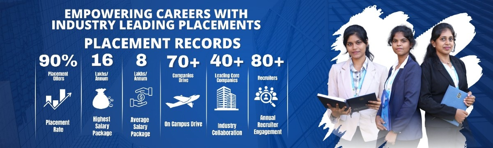

# GSBT Official Website

Official website for **Gojan School of Business and Technology (GSBT)**, a leading institution affiliated with Anna University. Live at [gsbt.edu.in](https://gsbt.edu.in/).

   
  
  
<b>GSBT Official Web Portal</b> — Comprehensive 85+ page institutional website built with responsive navigation & dynamic department routing

   

---

## 🏫 About the Institution

Gojan School of Business and Technology is a premier engineering and management institution in Tamil Nadu, India, offering B.E., B.Tech, MBA and MCA programmes under Anna University affiliation.

---

## 🎯 My Contribution

As the **Frontend Developer & UI Engineer**, I was responsible for:

- Architecting and developing the complete multi-department responsive portal (85+ pages).
- Implementing responsive layouts across all major sections — Academics, Admissions, Campus Life, R&D, Corporate, and Department pages.
- Designing and coding the full navigation system with multi-level department routing.
- Ensuring cross-browser compatibility and mobile-first responsive breakpoints.
- Optimizing page load performance, image delivery, and static asset pipeline.
- Coordinating with institutional stakeholders for content accuracy and design sign-off.

---

## 📄 Pages & Sections Developed

| Section | Pages |
|---|---|
| **Home** | Homepage, Hero Slider, News & Events, Announcements |
| **About** | Vision & Mission, Management, Accreditations |
| **Academics** | Programmes, Departments (ECE, CSE, IT, Mech, Civil, MBA, MCA...) |
| **Admissions** | Eligibility, Process, Fee Structure, Scholarships |
| **Campus Life** | Facilities, Clubs, Sports, Cultural Events |
| **Corporate** | Placements, Companies, Training & Development |
| **R&D** | Research Projects, Publications, Labs |
| **Utilities** | Contact, Gallery, Downloads, Footer |

---

## 🛠️ Technology Stack

- **Markup**: HTML5 (Semantic, Accessible)
- **Styling**: CSS3 (Responsive, Flexbox/Grid)
- **Interactivity**: Vanilla JavaScript
- **Image Optimization**: Compressed multi-format assets
- **Hosting**: Institutional server

---

## 🌐 Live Website

👉 **[https://gsbt.edu.in/](https://gsbt.edu.in/)**

---

## 📬 Contact

**Obaidhur Rahaman**  
Portfolio: [rahaman1721.framer.website](https://rahaman1721.framer.website)  
GitHub: [@rahaman1721](https://github.com/rahaman1721)  
LinkedIn: [obaidhur-rahaman-1721z](https://www.linkedin.com/in/obaidhur-rahaman-1721z)
